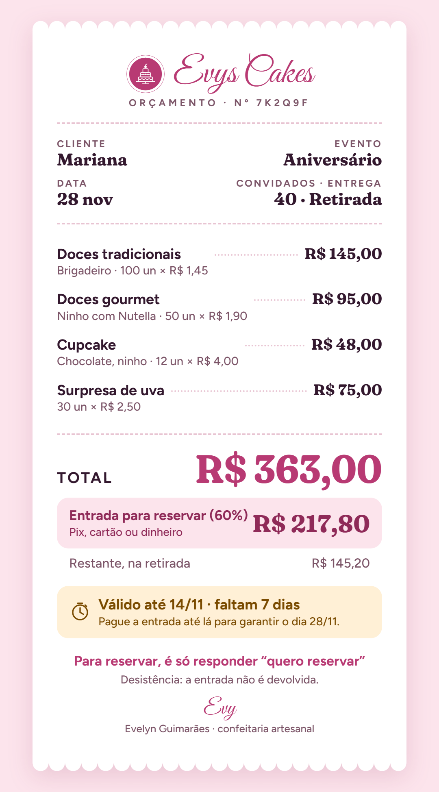
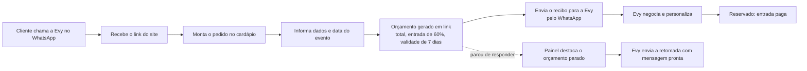

<div align="center">

# 🧁 Evys Cakes

**Do "quanto custa?" ao "pode reservar!": cardápio, orçamento em link e painel de acompanhamento para uma confeitaria artesanal.**




<sub>O recibo que a cliente envia para a Evy no WhatsApp (dados de exemplo).</sub>

</div>

---

## 📌 Sobre o projeto

Projeto desenvolvido no **Conectam**, hackathon de um dia realizado em parceria com o **BTG Pactual**, que conecta mulheres empreendedoras a alunas do **Inteli** para resolver desafios reais de seus negócios.

A empreendedora é a **Evy**, da **Evys Cakes**, uma confeitaria de encomendas personalizadas de doces para eventos. A venda acontece quase toda pelo WhatsApp, com atendimento individual, indicações e boca a boca.

### A dor

> "A cada 10 pessoas que entram em contato, 6 não fecham o pedido."

O que ouvimos da Evy:

- A maioria desiste **depois de receber o valor**: o cliente diz que vai comparar preços e some.
- Em casamentos, o orçamento é levado para o noivo(a) validar, e o contato esfria nesse intervalo.
- Quando o cliente para de responder, ela geralmente **não retoma**. Não há registro de contatos, status nem motivos de perda. Tudo fica na memória.
- Ela envia 30 a 40 orçamentos por mês, em texto no WhatsApp, e tem capacidade para produzir mais do que produz hoje.

Ou seja: o gargalo não está em montar o orçamento, está no que acontece **depois dele**.

---

## 💡 A solução

Um site em que o cliente **monta o próprio pedido** a partir do cardápio, vê o valor na hora e recebe um **orçamento em link**, com validade e entrada. A Evy acompanha tudo num **painel** e retoma quem parou de responder.

| Problema confirmado | Resposta no produto |
|---|---|
| Cliente vai comparar preços | Cardápio com preços e fotos e um orçamento claro (total, entrada, restante), que fica no celular dele em vez de se perder no chat |
| Cliente precisa validar com outra pessoa | Link do orçamento **compartilhável**: quem recebe vê tudo sem depender da Evy |
| Orçamento demora e esfria | **Validade de 7 dias**, com contagem regressiva na página. A Evy já aprovou essa ideia |
| Ninguém retoma o contato | Painel destaca os orçamentos parados e já deixa a **mensagem de retomada pronta** para ela aprovar e enviar |
| Nenhum registro de leads | Cada pedido salva cliente, evento, orçamento, status e motivo de perda |

### Por que não é um chatbot

Avaliamos um bot no WhatsApp e escolhemos **uma ferramenta que trabalha para a Evy**, não um robô que fala por ela:

- O gargalo está depois do orçamento, não no atendimento inicial.
- A relação pessoal é o que sustenta as indicações, então a mensagem final continua sendo dela.
- Enviar mensagem de dentro do número dela exige a API oficial do WhatsApp (aprovação da Meta, modelos de mensagem). Não cabe em um dia.

---

## 🔄 Como funciona



### Para a cliente

- **Cardápio** com fotos e preços por unidade, que já respeita os mínimos de cada produto.
- **Carrinho e resumo**: itens, total, entrada de 60% e restante na retirada.
- **Orçamento em link** (`/quote/[token]`): página privada com itens, total, validade com contagem regressiva, como reservar e regras.
- **Reservar data e tirar dúvida** abrem o WhatsApp da Evy com a mensagem pronta, e o botão de **compartilhar** manda o link para quem precisa validar.
- **Recibo em imagem**: o botão "Enviar para a Evy" gera um PNG do orçamento no próprio navegador e abre o compartilhamento com a imagem e uma mensagem pronta.

### Para a Evy (painel em `/dashboard`)

- **Login** protegido por senha, com sessão assinada em cookie.
- **Contadores**: orçamentos enviados, fechados, perdidos, taxa de conversão, quantos precisam de follow-up e o principal motivo de perda.
- **Lista de pedidos** com filtros (todos, parados, fechados, perdidos) e detalhe de cada um.
- **Retomada**: orçamentos sem resposta há mais de 2 dias aparecem em destaque, com botão que abre o WhatsApp com a mensagem de retomada já escrita.
- **Status do pedido**: marcar como fechado, perdido (com o **motivo**) ou reabrir, sempre com confirmação.
- **Calendário** com as datas dos eventos.

---

## 📋 Regras de negócio

Todas vêm do **Cardápio 2026** da Evy e de respostas dadas por ela. A lógica fica em [`lib/catalog.ts`](lib/catalog.ts) e [`lib/pricing.ts`](lib/pricing.ts), e o servidor **recalcula tudo** antes de gravar, então o preço nunca vem do navegador.

| Produto | Preço | Mínimo |
|---|---|---|
| Doces tradicionais | R$ 145 por 100 un. (R$ 1,45 cada) | 50 doces* |
| Doces gourmet | R$ 95 por 50 un. (R$ 1,90 cada) | 50 doces* |
| Cupcake | R$ 4,00 a unidade | 12 |
| Surpresa de uva | R$ 2,50 a unidade | 30 |
| Mini pão de mel | R$ 4,00 a unidade | 15 |
| Bolos (massa baunilha ou chocolate) | de R$ 90 a R$ 95 por kg, conforme o recheio | 1,5 kg |

<sub>* O mínimo de 50 doces vale para o pedido todo, somando tradicionais e gourmet.</sub>

- **Entrada de 60%** no ato da encomenda, e o restante na retirada. Em caso de desistência, a entrada não é devolvida.
- **Antecedência mínima de 7 dias.** Para datas mais próximas, o site orienta a falar com a Evy, porque ela às vezes aceita.
- **Validade do orçamento: 7 dias.**
- **Retirada** é o padrão. Entrega só é combinada no WhatsApp.
- **Personalização** (tema, cores, topper) é combinada direto no WhatsApp depois do orçamento.

---

## 🛠️ Tecnologias

| Camada | Escolha |
|---|---|
| Framework | [Next.js 16](https://nextjs.org) (App Router) + React 19 |
| Linguagem | TypeScript |
| Estilo | CSS próprio com tokens de marca + Tailwind CSS 4 |
| Banco de dados | [Supabase](https://supabase.com) (PostgreSQL) |
| Calendário | FullCalendar |
| Fontes | Fraunces, Figtree e Great Vibes (`next/font`) |
| Imagem do recibo | Canvas API, direto no navegador (sem dependência extra) |
| Testes | `node:test` |

---

## 🗂️ Estrutura

```
app/
  page.tsx               landing
  cardapio/              cardápio com carrinho
  pedido/                resumo e dados do evento
  quote/[token]/         página pública (privada por link) do orçamento
  login/                 entrada do painel
  dashboard/             painel da Evy (pedidos, detalhe, calendário)
  slides/                apresentação do projeto
components/              interface do site; components/dashboard e components/ui para o painel
lib/
  catalog.ts             produtos, preços e regras comerciais
  pricing.ts             cálculo do orçamento (com testes)
  receipt-image.ts       desenho do recibo em PNG
  dashboard/             sessão, dados, status e lógica do painel
proxy.ts                 protege /dashboard e /login
supabase/                schema.sql e seed.sql (dados de demonstração)
docs/                    guia de identidade visual e modelos do recibo
docs-empreendedora/      materiais da Evy (cardápio, modelo de orçamento)
```

---

## 🚀 Rodando localmente

**Requisitos:** Node.js 20 ou superior e um projeto no Supabase.

```bash
git clone https://github.com/nandahelena/evys-cakes.git
cd evys-cakes
npm install
```

### 1. Variáveis de ambiente

Copie `.env.example` para `.env.local` e preencha:

| Variável | Para que serve |
|---|---|
| `NEXT_PUBLIC_SUPABASE_URL` | URL do projeto Supabase |
| `NEXT_PUBLIC_SUPABASE_PUBLISHABLE_KEY` | Chave pública (publishable) do Supabase |
| `NEXT_PUBLIC_WHATSAPP_NUMBER` | WhatsApp da Evy, só dígitos com DDI e DDD (ex.: `5511999999999`). **Não é a chave Pix** |
| `ADMIN_PASSWORD` | Senha de acesso ao painel |
| `SESSION_SECRET` | Chave aleatória que assina a sessão do painel. Gere com `openssl rand -hex 32` e use uma diferente em produção |

### 2. Banco de dados

No **SQL Editor** do Supabase, rode [`supabase/schema.sql`](supabase/schema.sql) (tabelas `customers`, `orders` e `quotes`). Para ver o painel cheio, rode também [`supabase/seed.sql`](supabase/seed.sql), com dados fictícios. Todo cliente de demonstração tem e-mail terminando em `@demo.evys.test`, e o próprio arquivo explica como apagá-los.

### 3. Subir o projeto

```bash
npm run dev
```

Abra [http://localhost:3000](http://localhost:3000). O painel fica em `/login`.

### Scripts

| Comando | O que faz |
|---|---|
| `npm run dev` | Servidor de desenvolvimento |
| `npm run build` / `npm start` | Build e execução de produção |
| `npm run lint` | ESLint |
| `npm test` | Testes do cálculo de orçamento (mínimos, entrada de 60%, antecedência) |

---

## 🔐 Segurança e privacidade

- A **chave Pix da Evy não está no repositório**. Ela é um número de telefone e deve ficar fora do código.
- O link do orçamento usa um **token aleatório** de 32 caracteres, e a página pede aos buscadores que não a indexem.
- O painel exige sessão assinada, e o `proxy.ts` barra o acesso sem login.
- ⚠️ **Limitação de hackathon:** o `schema.sql` deixa o RLS do Supabase desligado e a proteção do painel fica só na aplicação. Antes de usar com clientes reais, é preciso ativar o RLS e criar as políticas.

---

## ✅ O que está confirmado e o que ainda é hipótese

**Confirmado com a Evy:** a maioria desiste depois de ver o valor; ela cobra entrada em todos os pedidos; aprova prazo de validade no orçamento; o Cardápio 2026 é o vigente; o nome da marca é Evys Cakes; geralmente o cliente retira o pedido.

**Hipóteses ainda a validar:**

- O cliente abre o link (hoje recebe texto) e montar o pedido sozinho não afasta quem hoje fecha na conversa. Um teste barato é mandar o link para 3 clientes reais.
- Gerar o orçamento no sistema é mais rápido para a Evy do que escrever o texto.
- O ganho está no pós-orçamento (validade, compartilhar, retomada) e não só em acelerar a montagem.
- O compartilhamento da imagem do recibo funciona em todos os celulares: falta testar em aparelhos reais.

**Perguntas em aberto para a Evy:** qual a taxa real de fechamento (ela citou 30% e 40%, com bases diferentes); quantos contatos novos chegam por mês; se a entrada é sempre 60%; e como deve funcionar uma futura relação com assessorias e buffets.

---

## 🔭 Próximos passos

- Bot que envia mensagem pelo número da Evy, via API oficial do WhatsApp.
- Pagamento com confirmação automática da entrada.
- Agenda de capacidade por data, ainda dependente de como ela decide aceitar pedidos.
- Área para assessorias e buffets (a Evy quer crescer nessa direção, mas ainda não sabemos como essa relação funcionaria).
- Ativar o RLS do Supabase e remover a dependência de proteção só no app.

---

## 📚 Documentação do projeto

- [`proposta-solucao.md`](proposta-solucao.md): proposta de solução da equipe, com fluxo completo e escopo do hackathon.
- [`CLAUDE.md`](CLAUDE.md): contexto do negócio, jornada atual e informações confirmadas pela Evy.
- [`docs/guia-de-identidade.html`](docs/guia-de-identidade.html): guia de identidade visual (cores, tipografia, logo, componentes).
- [`docs/orcamento-imagem/`](docs/orcamento-imagem): modelos HTML e PNG do recibo do orçamento.

---

## 👩‍💻 Equipe

Desenvolvido por alunas do **Inteli** — Fernanda Helena e Pietra — para a **Evy**, da Evys Cakes, no Conectam, em parceria com o BTG Pactual.

<div align="center"><sub>Feito com carinho e açúcar 🍰</sub></div>
